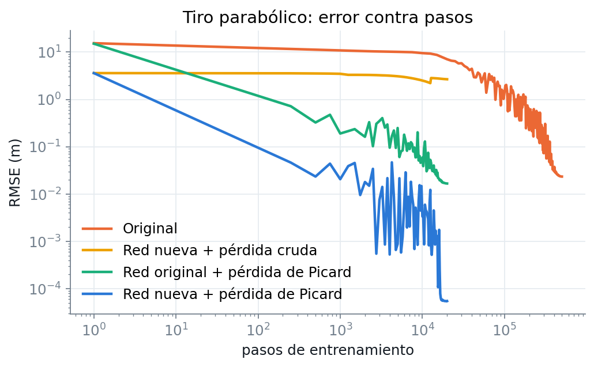
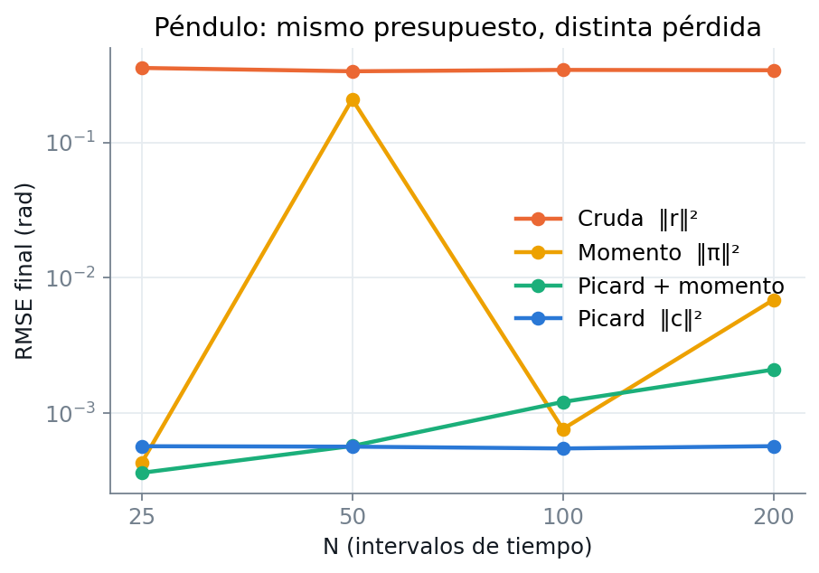
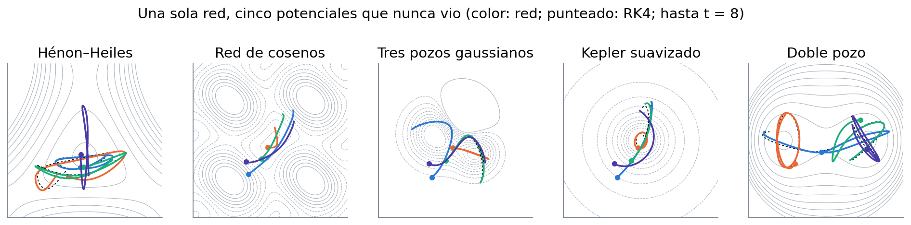

# Action Neural Network

Redes neuronales que aprenden a integrar sistemas mecánicos **sin datos**: lo único que se les da es el
Lagrangiano $L(q, v)$ y el principio de acción estacionaria.

Una red recibe la condición inicial $(q_0, v_0)$ y devuelve la trayectoria completa $q_1,\dots,q_N$.
Este repositorio contiene el proyecto de partida, un análisis de por qué su entrenamiento era tan lento,
una reformulación de la función de coste que lo corrige sin cambiar la física, y una extensión a
potenciales arbitrarios.

**Reporte completo con gráficas interactivas:** [`docs/index.html`](docs/index.html)
(GitHub no muestra HTML: descarga el archivo y ábrelo en el navegador).

## La idea

Con el Lagrangiano discreto de punto medio, la acción de una trayectoria es

$$S=\sum_{k=0}^{N-1}\Delta t\,L\!\left(\frac{q_k+q_{k+1}}{2},\ \frac{q_{k+1}-q_k}{\Delta t}\right)$$

y la trayectoria física es la que la deja estacionaria: $r_k=\partial S/\partial q_k=0$. El proyecto
original penaliza $\sum_k r_k^2$. Eso es correcto, pero $r_k$ es una segunda diferencia y su cuadrado
tiene un número de condición que crece como $N^4$: con $N=25$ ya es $6\times10^5$. Por eso hacían
falta 500 000 pasos para aprender una parábola.

La suma acumulada del residuo telescopa al balance impulso–momento, y sumada otra vez da el
**defecto de Picard**:

$$\pi_i=\sum_{j\le i}r_j=p_0+\Delta t\sum_{j<i}\frac{\partial L}{\partial q}\Big|_j+\frac{\Delta t}{2}\frac{\partial L}{\partial q}\Big|_i-\frac{\partial L}{\partial v}\Big|_i,
\qquad c_k=\Delta t\sum_{i<k}M^{-1}\pi_i=\Phi(q)_k-q_k$$

donde $\Phi$ integra dos veces las fuerzas evaluadas sobre la trayectoria propuesta y
$M=\partial^2L/\partial v^2$. La función de coste es

$$\mathcal{L}(\theta)=\mathbb{E}_{q_0,v_0}\left[\frac{1}{N}\sum_{k=1}^{N}\left\lVert\frac{c_k}{q_s}\right\rVert^2\right]$$

Tiene el mismo mínimo que la original, pero:

- su condición es exactamente 1 cuando las fuerzas no dependen de $q$, y no depende de $N$;
- está en unidades de posición, y su valor estima el error real sin conocer la solución;
- sólo usa derivadas de $L$ obtenidas por autograd, así que sirve igual con masas que dependen de
  la configuración o potenciales que dependen de la velocidad;
- el mismo $c$ es un corrector: $q\leftarrow q+c$ es una iteración de Picard.

## Resultados



| | |
|---|---|
| Tiro parabólico, dominio del proyecto original | el original llega a 2.3 cm en 500 000 pasos; la versión nueva iguala ese error en 1 000 pasos y termina en 0.055 mm |
| Cambiando sólo la pérdida (misma red y optimizador) | 32 veces menos pasos |
| Péndulo, error final contra $N$ | Picard: ~5.5·10⁻⁴ rad para $N$ = 25, 50, 100 y 200; pérdida cruda: 0.34 rad |



Sistemas no lineales, una red por sistema, error RMSE por ventana sobre 2000 trayectorias de prueba:

| Sistema | Ventana $T$ / $N$ | RMSE | con 2 correcciones de Picard |
|---|---|---|---|
| Péndulo (libración y rotación, $\omega^2$ como parámetro) | 1 / 50 | 1.4·10⁻⁴ rad | 2.5·10⁻⁶ |
| Hénon–Heiles (caótico) | 2 / 100 | 1.9·10⁻⁴ | 3.0·10⁻⁵ |
| Carga en campo magnético no uniforme | 0.5 / 25 | 5.2·10⁻⁴ | 1.0·10⁻⁴ |
| Péndulo doble (caótico, masa dependiente de $q$) | 0.5 / 25 | 1.2·10⁻³ rad | 1.5·10⁻⁴ |

### Un operador para potenciales arbitrarios

La red del operador universal no recibe parámetros ni fórmulas: recibe la velocidad inicial y los
valores de $V$ en una malla local de 13×13 puntos centrada en la partícula. Se entrena únicamente con
potenciales aleatorios y se evalúa, sin ajuste, en cinco potenciales que nunca vio. El error por
ventana queda entre 3·10⁻⁴ y 5·10⁻³.



## Límites

- **Ventanas largas.** La dificultad la controla $\Lambda T^2$ ($\Lambda$: curvatura del potencial). Con
  ventanas largas el entrenamiento fue inestable o divergió; las del reporte se eligieron después de
  ver esos fallos.
- **Gradiente completo o semigradiente.** Se puede derivar a través de $\Phi$ o tratar $\Phi(q)$ como
  blanco fijo. Ninguna variante fue robusta en todos los sistemas, y no hay todavía un criterio para
  elegir de antemano.
- **Fuerzas no acotadas.** Una primera versión del sistema magnético, con un campo que crecía como
  $r^2$, divergió con ambas variantes. El que se reporta usa un campo acotado.
- **Encadenar ventanas** sólo es fiable mientras el estado siga dentro del dominio de entrenamiento.
  En el péndulo doble deja de serlo hacia $t\approx10$.
- **Estadística.** Una sola semilla por configuración.
- **Novedad.** No se hizo una revisión bibliográfica sistemática. Las piezas tienen antecedentes
  claros (integradores variacionales, PINNs, DeepONets informados por física, formulaciones
  integrales); la combinación hay que contrastarla con la literatura antes de presentarla como nueva.

El reporte discute cada punto con sus datos.

## Estructura

```
varnet/            el método
  systems.py         sistemas mecánicos: cada uno es sólo un Lagrangiano
  universal.py       operador universal y potenciales de entrenamiento y prueba
  mechanics.py       mecánica variacional discreta: residuo, balance de momento, defecto de Picard
  losses.py          funciones de coste
  models.py          redes
  reference.py       integrador variacional y RK4 de referencia
  rollout.py         inferencia y encadenamiento de ventanas
  training.py        entrenamiento
experiments.py     todos los experimentos del reporte
bvp_action.py      qué pasa al minimizar la acción directamente
make_report.py     genera docs/index.html desde results/
make_figures.py    genera las figuras de este README
tests/             pruebas de las identidades matemáticas
results/           configuración, historial y métricas de cada corrida (JSON)
original/          el proyecto de partida, sin modificar
```

## Uso

```bash
pip install -r requirements.txt
python tests/test_identities.py            # o: python -m pytest tests
python experiments.py --list
python experiments.py proj_traj_pos        # tiro parabólico con la pérdida de Picard (~1 min en GPU)
python make_report.py                      # regenera el reporte
```

Añadir un sistema es escribir su Lagrangiano:

```python
import torch
import varnet as V
from varnet.systems import System, uniform

class Oscillator(System):
    name, d, T, N = "oscillator", 1, 1.0, 50
    separable = True

    def L(self, q, v, th):
        return 0.5 * v[..., 0] ** 2 - 0.5 * q[..., 0] ** 2

    def sample(self, B, device, dtype, gen=None):
        q0 = uniform(B, [-1.0], [1.0], device, dtype, gen)
        v0 = uniform(B, [-1.0], [1.0], device, dtype, gen)
        return q0, v0, torch.zeros(B, 0, device=device, dtype=dtype)

    def scales(self):
        return 1.0, 1.0, 1.0

system = Oscillator()
model = V.TrajNet(system)
testset = V.make_testset(system, 500, model.N, model.T)
V.train(system, model, loss="pos", steps=2000, batch=1024, testset=testset)
```

Los pesos entrenados no están en el repositorio (el modelo universal pesa 68 MB); cada corrida se
reproduce con `experiments.py`. Los resultados reportados se obtuvieron en Google Colab con una GPU
G4; la línea base original de 500 000 pasos, en CPU.

## El proyecto original

`original/` conserva el punto de partida tal como estaba: los cuadernos `main.ipynb` y `main_2.ipynb`,
sus versiones en script y las figuras de resultados. La formulación variacional de ese trabajo es
correcta y es la base de todo lo demás; lo que cambia aquí es la norma en que se mide el residuo.

## Licencia

MIT. Ver [`LICENSE`](LICENSE).
